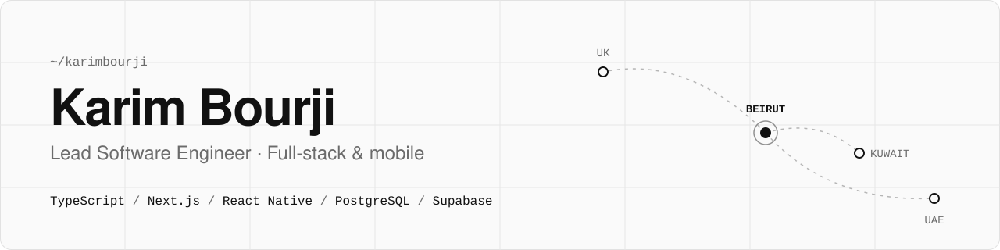

  

I'm a **Lead Software Engineer** based in Beirut. I take products from architecture to production and own the whole system: data, APIs, web and mobile, infrastructure and security. I've worked with teams and clients across **Lebanon, the UK, Kuwait and the UAE**.

 

  

<b>Read the engineering detail</b>

 

- **End-to-end ownership.** I cover everything from domain modeling and API design to deployment, monitoring and incident response. I own the system, not just the ticket.
- **Architecture that scales.** I design multi-tenant SaaS with stateless services that scale horizontally and background job queues for heavy work. I add caching only where it pays off, and I keep a clear path from one server to many without a rewrite.
- **Data done right.** PostgreSQL schema design, indexing and query tuning, zero-downtime migrations, and row-level security so tenant isolation is enforced by the database itself.
- **Observability & monitoring.** Error tracking with Sentry, structured logs, metrics, uptime checks and alert thresholds, so issues show up on a dashboard before a user reports them.
- **Performance under load.** Capacity planned from real numbers, load tests before launch, and profiling to find the actual bottleneck.
- **Security & reliability.** Server-side RBAC, encryption in transit and at rest, rate limiting, secrets management and audit trails. Encrypted off-site backups with point-in-time recovery and restores that are actually tested.
- **Delivery that lasts.** Containerized services, CI/CD on GitHub Actions, typed contracts end to end, automated tests, and runbooks, so any engineer can ship on day one.
- **Technical leadership.** Architecture decisions written down, trade-offs explained in business terms, and the judgment to pick the simplest solution that will hold.

 

<b>Stack as text</b>

 

**Languages:** TypeScript · SQL · Dart 
**Web:** Next.js (App Router) · React · Vite · TanStack Query · Zustand · Tailwind CSS · shadcn/ui 
**Mobile:** React Native · Expo · Flutter · Riverpod 
**Infra:** Linux VPS · Docker · Nginx · PM2 · Cloudflare 
**Compute:** Node.js · Supabase Edge Functions (Deno) · Firebase Cloud Functions 
**Data:** PostgreSQL · Row-Level Security · pg_cron · MySQL · Firestore 
**CI/CD & observability:** GitHub Actions · Vercel · Firebase Hosting · EAS Build · Sentry 
**Quality:** Vitest · Jest · Zod · PGlite database tests · ESLint

---

  <a href="https://karimbourji.com"><b>karimbourji.com</b></a> &nbsp;·&nbsp;
  <a href="mailto:kareembourji@gmail.com">kareembourji@gmail.com</a>
   
  Most of my work lives in private client and company repositories. Happy to walk through architecture and code in an interview.

